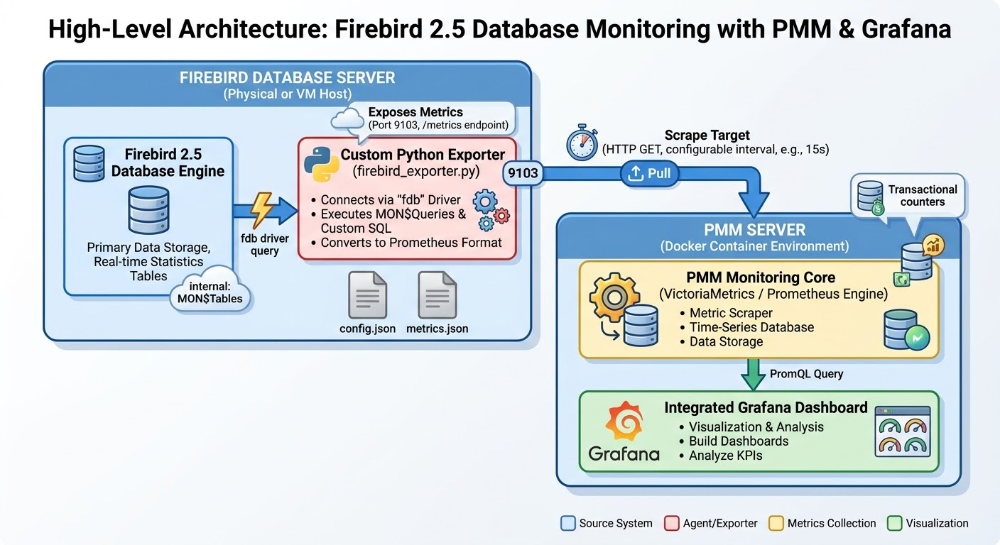

# Firebird 2.5 Prometheus Exporter & PMM Integration

[](https://www.python.org/)
[](https://www.firebirdsql.org/)
[](https://prometheus.io/)
[](https://opensource.org/licenses/MIT)

A lightweight, modular Python-based Prometheus Exporter specifically designed for **Firebird 2.5**. It exposes critical internal database statistics (such as Transaction Counters, OIT/OAT, Lock states, and custom SQL metrics) to **Percona Monitoring and Management (PMM)** and **Grafana**.

---

## 🏗️ Architecture Overview

The solution bridges Firebird 2.5 internal monitoring tables (`MON$*`) with PMM's time-series database and an external Grafana instance.



---

## 🚀 Features
* **Transaction Counter Monitoring:** Tracks `MON$NEXT_TRANSACTION`, `MON$OLDEST_TRANSACTION` (OIT), and `MON$OLDEST_ACTIVE` (OAT).
* **Garbage Collection Lag Detection:** Calculates the transaction gap (`Next - OIT`) to prevent database bloat.
* **Lock Management:** Monitors granted and waiting locks via `MON$LOCKS`.
* **Dynamic Custom Metrics:** Easily add custom SQL queries via a separate `metrics.json` file.
* **PMM & Grafana Ready:** Seamlessly integrates into Docker-based PMM environments and external Grafana setups.

---

## ⚙️ Installation & Setup (German / Deutsch)

### 1. Voraussetzungen & Abhängigkeiten
Installiere Python 3 und die benötigten Bibliotheken auf deinem Datenbank- oder Exporter-Server:
```bash
pip install fdb prometheus_client
```

### 2. Konfiguration
Lege einen Projektordner an (z. B. `/opt/firebird-exporter`) und platziere dort folgende Dateien:
* `firebird_exporter.py` (Das Hauptskript)
* `config.json` (Zugangsdaten)
* `metrics.json` (Optionale Custom Queries)

**Beispiel `config.json`:**
```json
{
  "server": {
    "port": 9103,
    "scrape_interval_seconds": 15
  },
  "database": {
    "dsn": "localhost:/pfad/zu/deiner/datenbank.fdb",
    "user": "SYSDBA",
    "password": "dein_passwort",
    "charset": "UTF8"
  }
}
```

### 3. Als Systemd-Dienst einrichten
Erstelle die Service-Datei:
```bash
sudo nano /etc/systemd/system/firebird-exporter.service
```
Füge folgenden Inhalt ein:
```ini
[Unit]
Description=Firebird 2.5 Prometheus Exporter
After=network.target

[Service]
Type=simple
User=root
WorkingDirectory=/opt/firebird-exporter
ExecStart=/usr/bin/python3 /opt/firebird-exporter/firebird_exporter.py
Restart=always
RestartSec=10

[Install]
WantedBy=multi-user.target
```
Dienst aktivieren und starten:
```bash
sudo systemctl daemon-reload
sudo systemctl enable firebird-exporter
sudo systemctl start firebird-exporter
```

### 4. Integration in PMM
Füge den Exporter als **External Service** in PMM hinzu (entweder über die PMM Web-UI unter *Configuration -> PMM Inventory -> Add Instance* oder via CLI):
```bash
pmm-admin add external \
  --service-name=firebird-exporter \
  --listen-port=9103 \
  --metrics-path=/metrics
```
## Testen des Exporters

Um die Funktionalität des Exporters und den Abruf der Metriken zu überprüfen, kannst du die bereitgestellte Testroutine (`test_exporter.py`) verwenden.

### 1. Voraussetzungen prüfen
Stelle sicher, dass der Exporter-Dienst läuft und auf Port `9103` erreichbar ist (entweder lokal oder via Docker).

### 2. Test-Skript ausführen
Das Testskript prüft, ob der Metrik-Endpunkt (`/metrics`) erreichbar ist und ob die erwarteten Prometheus-Metriken korrekt zurückgegeben werden.

Führe das Skript in deinem Terminal aus:
```bash
python3 test_exporter.py
```
---

## 🇬🇧 English Documentation

### Features
* **Transaction Monitoring:** Real-time tracking of transaction counters, OIT, and OAT.
* **Garbage Collection Health:** Monitors transaction gaps to avoid performance degradation.
* **Lock Tracking:** Measures active and waiting database locks.
* **Custom Queries:** Extend monitoring easily using `metrics.json`.

### Quick Start
1. Install dependencies: `pip install fdb prometheus_client`
2. Configure `config.json` with your Firebird 2.5 credentials and path.
3. Run manually to test: `python3 firebird_exporter.py`
4. Access metrics at: `http://<server-ip>:9103/metrics`
5. Register with PMM using `pmm-admin` or the PMM Web UI.

---

## 📄 License
This project is licensed under the MIT License - see the [LICENSE](LICENSE) file for details.
